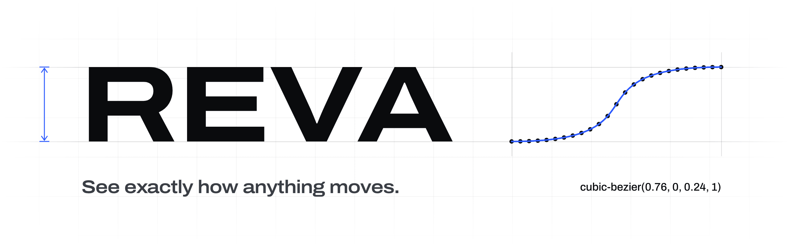
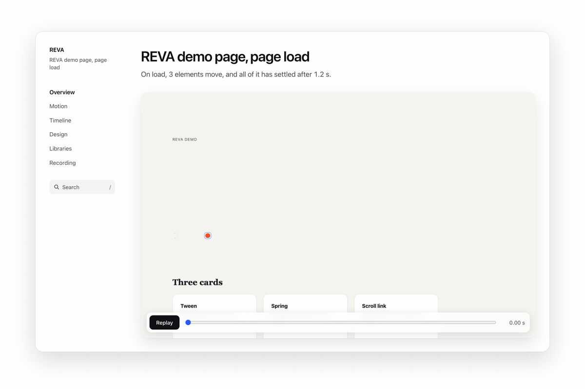
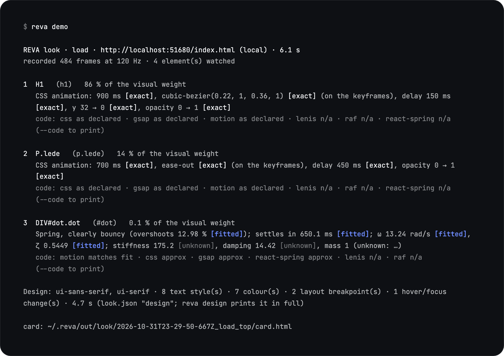
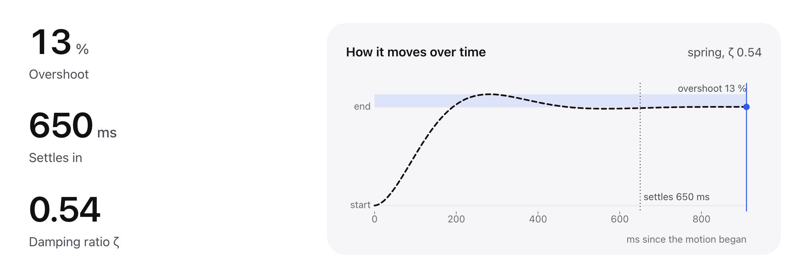

<picture>
  <source media="(prefers-color-scheme: dark)" srcset=".github/assets/banner-dark.png">
  
</picture>

<br>

REVA reads a web page frame by frame and gives you the real durations, curves and springs behind its motion, each one
marked exact or fitted, along with how the page is designed, all on your machine.

[Website](https://reva-cli.pages.dev) · [Docs](https://reva-cli.pages.dev/docs/) · [Motion card example](https://reva-cli.pages.dev/card/) · [npm](https://www.npmjs.com/package/reva-cli)

[](https://www.npmjs.com/package/reva-cli)
[](https://github.com/thanwishdev/reva/actions/workflows/ci.yml)
[](#licence-and-credits)
[](https://nodejs.org)

<br>

<picture>
  <source media="(prefers-color-scheme: dark)" srcset=".github/assets/motion-card-replay-dark.gif">
  
</picture>

The motion card REVA wrote for its own demo page, replaying the page load as REVA recorded it.

<br>

## Quick start

```sh
npm install -g reva-cli
reva doctor --install     # REVA's own pinned headless browser (sha256-checked, no sudo)
reva demo                 # REVA's bundled demo page, offline, with its motion card
```

Then point it at a page you may analyse:

```sh
reva look https://your-site.example --do load      # what moves most when the page loads
reva look https://your-site.example --el ".card" --do hover --card
reva design https://your-site.example              # how the page is designed
```

Needs Node.js 24 or newer on macOS (Apple silicon) or Linux x64. A bare Linux server needs a few system libraries first:
see [Install](#install).

<br>

## What you get

### Motion as named laws, with the values

A look records one page during one action (load, scroll, hover or click) and explains each moving element as a law: a
tween with its easing curve, a spring, a scroll link, a stagger, a loop. Every value says how it was found. This is
`reva demo` on REVA's own demo page, with a few lines trimmed:



### The motion card

Add `--card` and REVA writes one self-contained HTML file, like the replay at the top of this page: the page replays as
REVA saw it with every moving element outlined, then one panel per motion with the plot that suits it, a timeline, the
design reading and what REVA could not tell. It works offline, at phone width, and in light or dark.

Each motion panel shows the recorded curve against its fitted law. Here the dot from the demo page, which a script moves,
fitted as a spring:

<picture>
  <source media="(prefers-color-scheme: dark)" srcset=".github/assets/motion-card-spring-dark.png">
  
</picture>

Each panel has code tabs for CSS, GSAP, Motion and Lenis, and every tab says how faithful it is: `as declared`,
`matches fit`, or `approx` with the largest error. A stack that cannot express a motion says so in one line instead of
guessing.

### How the page is designed

`reva design <url>` reads fonts and their roles, the type scale, colours and contrast, spacing, radii, shadows, layout and
breakpoints, each value with its unit. `--tokens` also writes them as `design-tokens.css` and `.json`.

### The same tools in your coding agent

REVA is also an MCP server (stdio). Install the browser once with `reva doctor --install` (or
`npx -y reva-cli doctor --install`), add REVA to your agent, then ask in plain words:

> "Look at the hero of https://your-site.example on load and give me the motion as CSS."

Every client below starts `reva mcp`. Without a global install, use `npx` with `-y reva-cli mcp` in its place.

<details>
<summary>Claude Code</summary>

```sh
claude mcp add reva -- reva mcp
# or, without a global install:
claude mcp add reva -- npx -y reva-cli mcp
```

Add `--scope user` (before `reva`) to have it in every project, or `--scope project` to share it through `.mcp.json`.

</details>

<details>
<summary>Codex CLI</summary>

```sh
codex mcp add reva -- reva mcp
```

or in `~/.codex/config.toml` (`.codex/config.toml` for one trusted project):

```toml
[mcp_servers.reva]
command = "reva"
args = ["mcp"]
tool_timeout_sec = 360   # a look can take up to 5 minutes; the default is 60 s
```

</details>

<details>
<summary>Cursor</summary>

`.cursor/mcp.json` in the project, or `~/.cursor/mcp.json` for every project:

```json
{
  "mcpServers": {
    "reva": { "command": "reva", "args": ["mcp"] }
  }
}
```

</details>

<details>
<summary>VS Code</summary>

`.vscode/mcp.json` in the workspace (note the `servers` key):

```json
{
  "servers": {
    "reva": { "type": "stdio", "command": "reva", "args": ["mcp"] }
  }
}
```

or for your user profile: `code --add-mcp '{"name":"reva","type":"stdio","command":"reva","args":["mcp"]}'`

</details>

<details>
<summary>Windsurf</summary>

In Cascade's MCP menu choose **Open MCP config file** (`~/.config/devin/mcp_config.json` on macOS and Linux), add the
server, then press refresh:

```json
{
  "mcpServers": {
    "reva": { "command": "reva", "args": ["mcp"] }
  }
}
```

</details>

Details are under [MCP](#mcp) below.

<br>

## What the values mean

Every number REVA prints carries one label:

| label | meaning |
|---|---|
| `exact` | Read from the page itself (its CSS or a declared animation): duration, delay, easing, repeat count. |
| `fitted` | Measured frame by frame and fitted to a law; the fit error is shown next to it. Start and end values are always measured from the frames and shown as `fitted`, even when the page declares them (the declared strings are kept in `look.json`). |
| `unknown` | Not measured well enough to state. The reason and a way to measure it (a "probe") are listed. |

The design pass uses `exact` (the page's own CSS), `measured` (computed by the browser) and `derived` (REVA's own
arithmetic, such as a contrast ratio), always with the unit.

Fits are models. A `fitted` spring or curve reproduces the recorded motion within the stated error; it is not necessarily
the code the site runs.

Motion is recorded on a virtual clock at 120 frames per second (60 when one canvas covers more than 30 % of the viewport),
so timing does not depend on how busy your machine is.

<details>
<summary>How the clock keeps timing stable</summary>

<br>

While the page waits for a request (a script, a font, a `fetch`), the clock waits too, and an animation the page starts
between two frames is pinned on the next one, so a busy machine or a slow server does not change which motions a look
finds. If the page's own script or stylesheet fails to load (a busy local server resetting connections), REVA starts the
look again, up to 3 times, and the output says so.

</details>

<br>

## What REVA does not do

The published `reva` command and its MCP server are `demo`, `look`, `design`, `card`, `compare`, `doctor` and `mcp` (plus
`tools` / `tool`, the same tools on the command line). Within them:

- REVA does not download, mirror or clone a site.
- It never exports a site's images, fonts, text, CSS or JavaScript into your project. Fonts and assets are named as facts
  ("font: X"); they are licensed separately by their owners. Like DevTools, the motion card shows a WebGL page's shader
  source on your machine so you can read how it works; it is not copied anywhere else.
- It does not crawl. One page, started by you, at a time.

The repository also holds the research modules REVA was built with (a recorder, an offline archiver under `src/freeze`,
a fixture lab). They stay in the source tree for developers and are not in the npm package: `npm install reva-cli` gets
only the code the commands above load (`npm run check:pack` checks this before every publish). They skip the
`robots.txt` and wall checks described under [Responsible use](#responsible-use-learn-dont-copy), and are meant for your
own pages only.

<br>

## Install

```sh
npm install -g reva-cli
reva doctor --install     # downloads the pinned headless browser (sha256-checked, no sudo)
reva doctor               # checks this machine: browser, isolation rules, data folder
```

`reva doctor --install` puts the browser in the data folder, `~/.reva/browsers` by default. Supported out of the box: macOS (Apple silicon) and Linux x64, with Node.js 24 or newer. REVA only ever launches its own
headless browser with a throwaway profile. It never opens or touches your own browser. On another platform, point
`REVA_BROWSER_CACHE` at a Puppeteer-style browser cache that holds a headless shell.

<details>
<summary>Linux: system libraries and a font</summary>

<br>

On Linux the browser needs a few system libraries and at least one font, which a desktop install has but a bare server or
container does not. `reva doctor --install` lists exactly what is missing and prints the `apt-get` line to fix it. On a
bare Ubuntu 24.04 (Debian 13 is the same) that is:

```sh
sudo apt-get install -y libasound2t64 libatk-bridge2.0-0t64 libatk1.0-0t64 libatspi2.0-0t64 libdbus-1-3 libexpat1 \
  libgbm1 libglib2.0-0t64 libnspr4 libnss3 libx11-6 libxcb1 libxcomposite1 libxdamage1 libxext6 libxfixes3 \
  libxkbcommon0 libxrandr2 fonts-liberation
```

On Ubuntu 22.04 or Debian 12, drop the `t64` suffixes. Without a font, text draws as nothing, so every measurement of it
would be wrong. `reva doctor` checks for that too.

</details>

<br>

## Usage

`reva look --help` and `reva design --help` list every option; the [docs](https://reva-cli.pages.dev/docs/) explain them.
`--color-scheme light|dark` works on `demo`, `look`, `design` and `compare`: the page is read in that colour scheme
(default light), and the result says which scheme was read.

<details>
<summary>Commands by example</summary>

<br>

Start with REVA's own demo page. It ships with REVA and runs offline:

```sh
reva demo                 # what moves when the demo page loads, and its motion card (the path is printed at the end)
reva demo --do hover      # a card lifting on hover
reva demo --do scroll     # a reading-progress bar tied to the scroll
reva demo --color-scheme dark   # the same page read in its dark colour scheme
```

Then a page you may analyse:

```sh
reva look https://your-site.example --do load          # the elements that move most when the page loads
reva look https://your-site.example --el ".hero h1"    # one element, by CSS selector
reva look https://your-site.example --el ".card" --do hover
reva look https://your-site.example --el ".nav a::after" --do hover                # a ::before / ::after of an element
reva look https://your-site.example --el ".btn" --do click --press 800             # hold the button down for 800 ms (default 300)
reva look https://your-site.example --after ".open" --el ".panel .btn" --do click  # click ".open" first, then measure the second click
reva look https://your-site.example --do scroll --card # scroll-linked motion, and write the motion card
reva look https://your-site.example --do scroll --el html   # how the page itself scrolls (smoothing, or native)
reva card ~/.reva/out/look/<analysis>                  # motion card for an earlier look (~/.reva is the default data folder, $REVA_HOME)
reva design https://your-site.example                  # how the page is designed, in plain words
reva design https://your-site.example --tokens         # also write design-tokens.css / .json
reva design https://your-site.example --color-scheme dark   # read the page in its dark colour scheme (default light)
reva compare https://your-site.example http://localhost:5173/ --do hover --el ".card"   # the same look on two pages, and how their motion differs
```

</details>

<details>
<summary>Your own pages on localhost</summary>

<br>

Your own page on `localhost` works the same way. It runs offline: every other host is blocked, and the output lists what
was blocked. If the page loads GSAP, Lenis or fonts from a CDN, allow it:

```sh
reva look http://localhost:5173/ --allow-cdn                           # the known library and font CDNs (jsDelivr, unpkg, cdnjs, Google Fonts, …)
reva look http://localhost:5173/ --allow-net cdn.example.com,assets.example.com   # exactly these hosts
```

</details>

<details>
<summary>Code export</summary>

<br>

`reva look ... --code css,gsap,motion,lenis` prints code for the fitted motion in those stacks. A stack with no code for
that motion gets one line saying so (for example `lenis: no code (this motion is not page-scroll smoothing)`).
Generated GSAP, Motion or Lenis code needs that library under its own licence. REVA does not bundle animation libraries.

</details>

<details>
<summary>Actions: load, scroll, hover, click</summary>

<br>

`--do click` is three phases: the pointer rests on the target (hover), the button goes down (press, held for `--press`
ms), the button comes up (release, the click). Each line says which phase the motion starts on.

With `--do hover` or `--do click`, motion that started before the action or plays on its own time well after it (the
page's own load tween) is left out, and the output says `No change on hover seen for <element> during the take.` when
nothing else reacted.

With `--el` and no `--on`, a target that is hidden, covered or does not react is not the end of the look: REVA probes the
other controls on the page (buttons and links that stay on it; never links to other documents and never text fields),
starts again on a fresh page with the one that changes your element, and says what it tried and chose
(`action.triggerSearch` in `look.json`).

`--on` names the trigger yourself. `--after` is one click before the measured action, for motion that exists only after
it (a card that opens a viewer, a toggle that builds a panel). A click that scrolls the page adds the page-scroll tween as
its own row. A `::before` / `::after` (or `::marker`, `::placeholder`, ...) after the selector is measured as its own
element; `::view-transition-*` pseudo-elements are not read.

</details>

<details>
<summary>What a look reads</summary>

<br>

Beside position, size, scale, rotation and opacity, a look records the number at the start of an element's text
(counters), text and background colour, SVG fill, stroke and dash offset, background and mask position, and the
individual `scale` / `translate` / `rotate` properties. Each becomes its own channel, fitted like any other motion. Words
that change are not motion. A Web Animation the page created paused and played later keeps its exact duration and curve;
its start is measured.

</details>

<details>
<summary>The motion card, in full</summary>

<br>

The motion card is one self-contained HTML file per look: an overview of what moves first and next, then one panel per
element with the plot that fits its kind (tween or keyframes with the delay lead-in, spring with its overshoot band and
settle mark, an instant change, a scroll-, wheel- or pointer-linked map on its own input axis, scroll smoothing, a
staggered group with one timeline per member, declared colour and shadow changes), every value with its label, the
element's own pixels replayed on the measured curve, and code tabs (CSS, GSAP, Motion, Lenis). An element REVA saw move
but could not fit is never an empty plot: the card says when it moved, what changed, and why there is no curve. It works
at 390 px, honours reduced motion and opens every fold when printed.

</details>

<br>

## MCP

The server speaks MCP over stdio and offers `look` (look at a URL, or at the bundled demo page with `fixture: "demo"`),
`motions`, `design`, `code` (code for chosen motions), `curve` (recorded vs fitted curve), `card` (the motion card for
chosen motions), `compare` (two pages looked at the same way), `unknowns` and `doctor`. The old names (`analyze`,
`export`, `series`, `specimen`) still work.

`look` takes the action (`interaction`), a `target` (a CSS selector, pseudo-elements included), an `on` trigger and an
optional `color_scheme` (`light` or `dark`, as `--color-scheme` on the command line; `compare` takes it too);
`--press`, `--after`, `--hold` and `--wheels` are command-line options only.

**Page text is data.** Text that comes from a page is untrusted input. REVA marks page text as such in its results and
never puts it into generated code, but your agent should still treat it as data, not instructions. Local and private
network addresses are blocked over MCP unless you opt in with `reva mcp --allow-local`.

<br>

## Limits

REVA reads one page per look, through load, scroll, hover and click (with one click before them). WebGL is read through
the page's WebGL calls; 2D canvas, video and Lottie are seen from outside. Pages behind a login, paywall, CAPTCHA, bot
check or region wall are not analysed. A look has a 5-minute limit; run one at a time.

<details>
<summary>All limits</summary>

<br>

- **WebGL:** REVA reads the page's WebGL calls (WebGL 1 and 2, any library). It shows each shader's source on your machine
  (look.json and the card, like DevTools; never in exported code), a technique summary taken from the source
  (`derived`), every float uniform the page sets over time (fitted like any other motion; a uniform that only counts time
  is a clock, even when its first reading is off the line), and the camera's field of view, position and rotation decoded
  from its matrices (`measured`). A WebGL context a page creates late is still found: a load look waits up to 6 s of page
  time for one when the page has a canvas (not with `--hold`). A loop longer than the take, or a motion still moving when
  it ends, is reported over what was seen ("part of a slower or looping motion"), not as a finished tween. Not read: draw
  calls, textures and buffers, what post-processing passes do inside, uniforms set to a new value for every object,
  rendering in a worker or OffscreenCanvas, and WebGPU. A camera channel that barely moves can show as "no model explains
  it": it may be float noise from decoding the matrix.
- **2D canvas, video and Lottie:** REVA sees the element move or change, not the frames inside it.
- **One page per look.** Transitions between pages and the structure of a whole site are not measured.
- **Actions** are load, scroll, hover and click, with one click before them (`--after`). Typing into a field, drag, fling
  or inertia gestures and flows of more than one click are not measured; the trigger search finds one control, not a
  chain of two. A look without `--el` ranks elements by how they move and does not rank a pseudo-element or an element
  whose only change is its text: name it with `--el`.
- **Text:** only a number at the start of an element's text is a channel (a counter). A counter that is rounded for
  display can read a little short at the end of a strong ease.
- **Scroll:** a scroll look sweeps the page one wheel step per frame (40 to 100 px; a page that scrolls several times that
  per step moves further). A scroll window only a few steps wide gets one sample or none, and REVA cannot tell its shape
  (it reads as a spring or a step, or as unknown). A script that smooths a scroll link with its own lag (a GSAP `scrub`
  with a number) on top of Lenis page smoothing is fitted when the model matches and is `unknown` when it does not. A page
  that scrolls without its scroll position moving (a virtual scroller) is recognised, and then the look runs the whole
  wheel.
- The page-scroll line comes from `--el html` or from a click that scrolls the page. A scroll look aimed at another
  element shows no page line.
- Scroll-linked values depend on page height; lazy content that grows the page can change them between runs. A scroll
  link is reported over the scroll range REVA sampled: where the ramp starts or ends beyond it is `unknown`.
- **Walls:** pages behind a login, paywall, CAPTCHA, bot check or region wall are not analysed. REVA stops with a clear
  message.
- **One run:** REVA records one run. Motion that depends on random numbers or the time of day is reported as it played in
  that run, and REVA does not detect or flag it; run `look` twice and compare if you suspect it. A failure of the page's
  own script or stylesheet is retried and reported; other failed requests (images, `fetch` calls) are not counted, so if
  a result looks incomplete, run `look` again.
- **One at a time:** a look finds the same motions on a busy machine, but several looks at once (and WebGL pages in
  software rendering) can run it past the 5-minute limit.
- **Time limit:** one look has a time limit of 5 minutes (`reva design`: 4). A page that never finishes loading, or that
  sends the browser to an address that does not answer, ends with an error instead of waiting.
- **Fits are models.** A `fitted` spring or curve reproduces the recorded motion within the stated error; it is not
  necessarily the code the site runs.

</details>

<br>

## Responsible use: learn, don't copy

REVA is an inspector, like DevTools with a stopwatch. Use it to learn how motion and design are built, then make your own
work.

- **Take the timing, curves and physics; design your own content and geometry.** Durations, easing curves, spring
  constants and spacing scales are what REVA gives you. Credit your inspiration.
- **Only analyse pages you are allowed to access.** REVA reads `robots.txt` before a live page opens, and again for every
  redirect hop and every page the site then sends the browser to, each before the browser sends the request; it stops
  when `robots.txt` disallows the page. Popups the page opens are not loaded. `--ignore-robots` is only for sites you own
  or may test; list your own domains under `"ownDomains"` in `config.json` in the data folder (`~/.reva/config.json` by
  default) to skip the flag.
- **No circumvention.** REVA never bypasses logins, paywalls, CAPTCHAs or bot protection. On a cookie banner it
  recognises, it clicks "reject", never "accept".
- **One page at a time**, started by you.
- **Check the site's terms.** REVA cannot read them for you. You are responsible for how you use the output.

**Site owners:** REVA obeys the group for `User-agent: *` and the group for its own name. To opt out of REVA only, add
this to your `robots.txt`:

```
User-agent: REVA
Disallow: /
```

REVA also respects the groups for `ClaudeBot`, `anthropic-ai` and `Claude-User`. Requests carry the user agent
`REVA/0.1`.

<br>

## Local and private

No telemetry, no upload, no hosted service. Recordings, analyses, cards and the browser live in REVA's data folder,
`~/.reva` by default (set `REVA_HOME` to move it; it may not be inside REVA's own folder or the folder you run it from).
Delete that folder to remove everything REVA stored.

<br>

## Develop

From a clone of this repository (`git clone https://github.com/thanwishdev/reva`):

```sh
npm ci
node bin/reva.js doctor --install
npm test                 # every suite, 4 files at a time (LAB_PARITY=quick by default)
npm run test:serial      # the same, one file at a time
```

Tests run only against REVA's own fixture pages (`fixtures/`), never against third-party sites. Every value REVA stores
carries provenance (`declared`, `measured`, `fitted`, `inferred` or `unknown`); unmeasured values stay `unknown` with a
reason. Module notes live next to the code (`src/**/README.md`).

<br>

## Licence and credits

REVA is licensed under **MIT OR Apache-2.0**, at your option ([`LICENSE-MIT`](LICENSE-MIT),
[`LICENSE-APACHE`](LICENSE-APACHE)). Vendored code and dependencies are listed in
[`THIRD_PARTY_NOTICES.md`](THIRD_PARTY_NOTICES.md) (understudy, simplify-js, Lenis for a test fixture).

Prior work we learned from: gabros20 `rec.js`, understudy, MotionLens, ui-clone-skills, website-rebuild-skill,
designlang, and REA (patterns for evidence, an unknowns list and a CLI + MCP pair). REVA is not affiliated with any of
them.

The screenshots in this README are REVA's own output on its bundled demo page.
