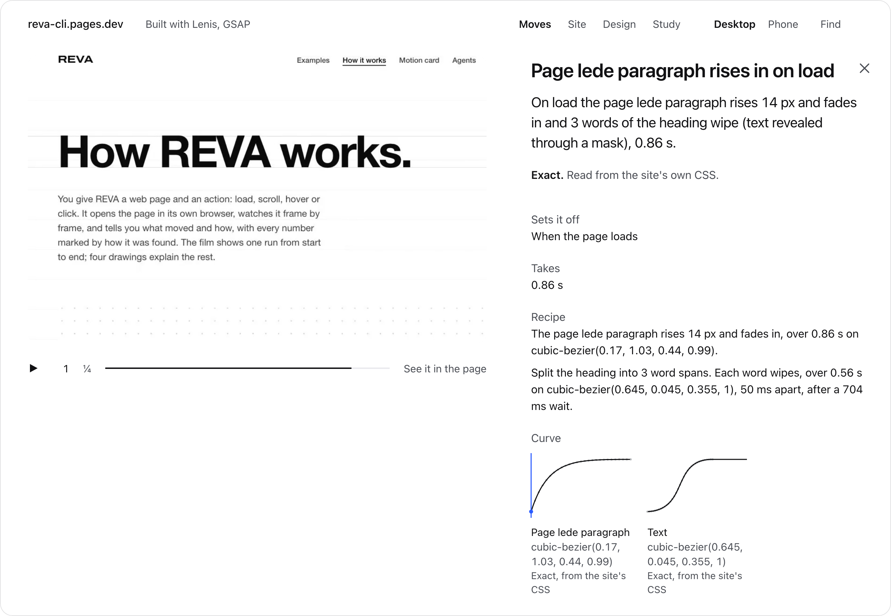
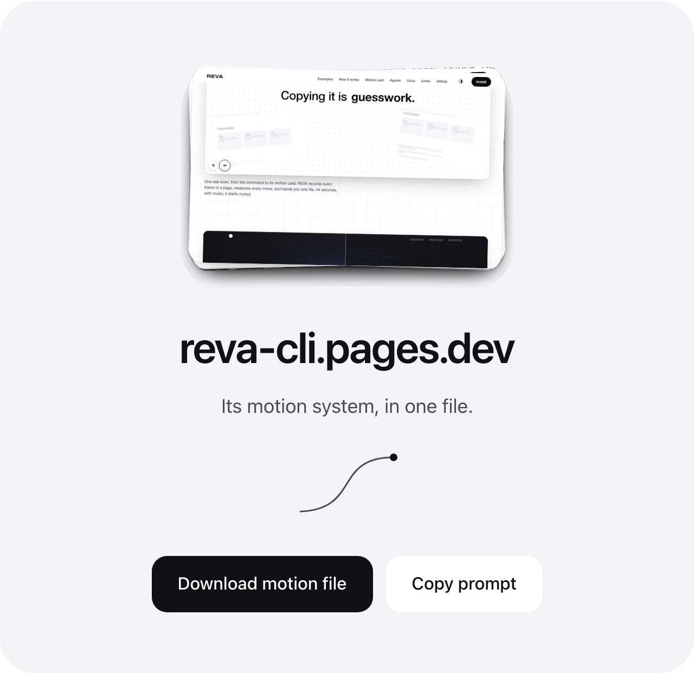
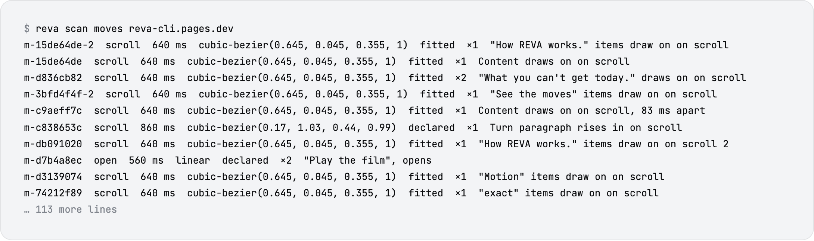

<p align="center">
  <a href="https://reva-cli.pages.dev">
    <picture>
      <source media="(prefers-color-scheme: dark)" srcset=".github/assets/banner-dark.svg">
      
    </picture>
  </a>
</p>

<p align="center">
  <b>See exactly how any website moves.</b><br>
  REVA records a page frame by frame and gives you the real durations, curves and springs behind its motion,<br>
  each one marked exact, fitted or unknown.
</p>

<p align="center">
  <a href="https://reva-cli.pages.dev">Website</a> ·
  <a href="https://reva-cli.pages.dev/docs/">Docs</a> ·
  <a href="https://reva-cli.pages.dev/examples/">Examples</a> ·
  <a href="https://reva-cli.pages.dev/how-it-works/">How it works</a> ·
  <a href="https://reva-cli.pages.dev/agents/">Agents</a>
</p>

<p align="center">
  <a href="https://www.npmjs.com/package/reva-cli"></a>
  <a href="https://github.com/thanwishdev/reva/actions/workflows/ci.yml"></a>
  <a href="#licence"></a>
  <a href="https://www.npmjs.com/package/reva-cli"></a>
  <br>
  <a href="https://nodejs.org"></a>
  <a href="#platforms"></a>
  <a href="#privacy"></a>
</p>

<p align="center">
  <a href="https://reva-cli.pages.dev/">
    
  </a>
  <br>
  <sub>Ten seconds of the launch film. The whole film, 44 seconds with sound, plays below and on <a href="https://reva-cli.pages.dev/">the site</a>.</sub>
</p>

https://github.com/user-attachments/assets/4ecf3423-12db-4341-a7a4-9cde8afc652e

DevTools shows you the motion a page declares in CSS. It can't show motion that a script drives frame by frame, and
that is how most springs, GSAP timelines and smooth scrolling work. REVA measures that motion on its own clock, so you
get numbers instead of guesses.

## Quick start

```sh
npm install -g reva-cli
reva doctor --install     # REVA's own pinned headless browser, sha256-checked, no sudo
reva demo                 # reads REVA's bundled demo page offline, so you see a result first
```

Then scan a site you're allowed to read:

```sh
reva scan https://your-site.example --out your-site
```

A scan records one page for each template, on desktop and phone, and writes one folder. Open `your-site/card.html`.
Add `--one-page` to scan only the page you typed. `reva scan --help` says exactly what a scan does to the site.

## What you get

**A card of how the site moves.** `card.html` opens from disk. It starts with the site's motion in a few plain
sentences: how long things take, which curves they ease on, how groups arrive. Then come the moves it found, grouped
by what sets them off: arriving, scrolling, hover and press, opening and closing, between pages, always running.

This one is a scan of REVA's own website. It covered 8 pages on desktop and phone and found 123 moves: 44 declared,
31 fitted, 44 sampled and 4 seen.

<p><picture>
  <source media="(prefers-color-scheme: dark)" srcset=".github/assets/scan-card-dark.png">
  
</picture></p>

**Every move, opened.** Click a move to replay it beside what sets it off, how long it takes, the recipe in words, its
curve, and how REVA knows. Under that sits the code for CSS, GSAP or Motion, and a prompt for your agent.

<p><picture>
  <source media="(prefers-color-scheme: dark)" srcset=".github/assets/scan-card-move-dark.png">
  
</picture></p>

**The motion system, in one file.** The card ends with two buttons. **Download motion file** saves
`<host>-motion.md`, the site's motion written out for your own project. **Copy prompt** copies the same thing as a
prompt for a coding agent.

<p align="center"><picture>
  <source media="(prefers-color-scheme: dark)" srcset=".github/assets/scan-card-file-dark.png">
  
</picture></p>

**The same moves for an agent.** The folder also holds `moves.json`, one file per move in `moves/`, and
`coverage.json`, a ledger of what was and wasn't captured. `reva scan moves <dir>` lists the moves, and
`--id <move>` prints one in full, with its code.

<p><picture>
  <source media="(prefers-color-scheme: dark)" srcset=".github/assets/terminal-dark.png">
  
</picture></p>

**One element, one moment.** `reva look <url> --do hover --el "<selector>"` records a single action (`load`,
`scroll`, `hover` or `click`) and prints how each element moves: a tween with its curve, a spring, a scroll link, a
stagger or a loop, every value marked `exact`, `fitted` or `unknown`. `--card` writes it as one offline HTML file, and
`--code` prints CSS, GSAP, Motion, Lenis, requestAnimationFrame or React Spring. Each snippet says how faithful it is:
`as declared`, `matches fit`, or `approx` with the largest error.

**The design, too.** `reva design <url>` reads the fonts and their roles, the type scale, colours and contrast,
spacing, radii, shadows and breakpoints. `--tokens` writes them out as design tokens.

**Two pages, compared.** `reva compare <url-a> <url-b>` looks at both the same way and tells you where their motion
differs, value by value. Use it to check your rebuild against the original.

## How it works

1. **It asks first.** REVA reads `robots.txt` before any page opens, and stops at a login, paywall or bot check.
2. **It records on a virtual clock.** The page runs in REVA's own headless browser at a steady 120 frames per second
   of page time, so a busy machine doesn't change the timing.
3. **It reads what the page declares, and fits the rest.** Declared motion is read as written. Everything else is
   fitted to a curve or a spring from the recorded frames.
4. **It checks itself.** A look runs the same action again in a fresh browser and flags a motion that differs
   between the two runs. A scan keeps a ledger of everything it could not capture, with the reason.

Every value then carries one of three labels:

| label | meaning |
|---|---|
| `exact` | Read from the page itself: CSS, Web Animations, GSAP, Lenis, Swiper, Lottie, Locomotive or anime.js. |
| `fitted` | Measured frame by frame and fitted to a curve or spring, with its error. |
| `unknown` | Not measured well enough to state. REVA gives the reason and a way to measure it. |

A scan's move list says the same thing in its own words: `declared`, `fitted`, `sampled` or `seen`. A fit is a
model. It reproduces the recorded motion within the stated error, but it isn't necessarily the code the site runs. [The longer version](https://reva-cli.pages.dev/how-it-works/)

## In your coding agent

REVA is also an MCP server with 11 tools, so you can ask in plain words: *"Look at the hero of
https://your-site.example on load and give me the motion as CSS."* After a scan, the tools `scan_moves` and
`scan_move` read its folder.

```sh
claude mcp add reva -- reva mcp
```

<details>
<summary>Codex, Cursor, VS Code, Windsurf</summary>

<br>

Every client starts `reva mcp`. If REVA isn't installed globally, use `npx -y reva-cli mcp` instead.

- **Codex CLI:** `codex mcp add reva -- reva mcp`. In `config.toml`, set `tool_timeout_sec = 360`, because a look can
  take up to 5 minutes.
- **Cursor:** `.cursor/mcp.json` → `{ "mcpServers": { "reva": { "command": "reva", "args": ["mcp"] } } }`
- **VS Code:** `.vscode/mcp.json` → `{ "servers": { "reva": { "type": "stdio", "command": "reva", "args": ["mcp"] } } }`
- **Windsurf:** in Cascade's MCP menu, choose **Open MCP config file**, then add the same `mcpServers` entry as Cursor.

</details>

Text from a page comes back marked as untrusted, so your agent treats it as data, not instructions. Local addresses
are blocked over MCP unless you start the server with `reva mcp --allow-local`.
[All tools and options](https://reva-cli.pages.dev/agents/)

## Platforms

- **macOS on Apple silicon** and **Linux x64** are supported.
- A bare Linux server needs a few system libraries and one font. `reva doctor --install` prints the exact `apt-get`
  line.
- Windows and Intel Macs aren't supported yet.

You need Node.js 24 or newer. `reva doctor` checks the machine and tells you what is missing.

## Privacy

REVA runs entirely on your machine. There is no account, no upload and no telemetry. It talks to the network twice:
once when `reva doctor --install` downloads its pinned browser from the Chrome for Testing bucket, and whenever you
point it at a page. Results stay in `~/.reva/out` or the folder you choose. REVA uses its own browser with an isolated
profile and never touches your Chrome.

## Limits

- A scan records one page for each template, not every page, and menus and dialogs one level deep.
- A look reads one page through one action, and takes up to 5 minutes. Run one at a time.
- WebGL is read through the page's WebGL calls. 2D canvas, video and Lottie are seen only from outside, and REVA
  doesn't read WebGPU.
- REVA stops at logins, paywalls, CAPTCHAs, bot checks and region walls.

[All limits](https://reva-cli.pages.dev/limits/)

## Responsible use

REVA is an inspector, like DevTools with a stopwatch. Take the timing, the curves and the physics, and design your
own content. REVA never puts a site's images, fonts, text or code into your project. A scan waits at least 500 ms
between requests to a host and stops on a 429. You're still responsible for following a site's terms.

To opt your site out of REVA only, add this to your `robots.txt`:

```
User-agent: REVA
Disallow: /
```

## Docs

- [Docs](https://reva-cli.pages.dev/docs/): install, every command and its options, troubleshooting
- [How it works](https://reva-cli.pages.dev/how-it-works/): one look from start to end
- [The motion card](https://reva-cli.pages.dev/card/): what the card shows
- [Agents](https://reva-cli.pages.dev/agents/): MCP setup for each client, and every tool
- [Examples](https://reva-cli.pages.dev/examples/): pages we built, the values we wrote and what REVA read
- [Limits](https://reva-cli.pages.dev/limits/): what REVA doesn't read

## Contributing

```sh
git clone https://github.com/thanwishdev/reva && cd reva
npm ci && node bin/reva.js doctor --install
npm test
```

Tests run only against REVA's own fixture pages, never against third-party sites. [`CONTRIBUTING.md`](CONTRIBUTING.md)
has the ground rules, [`CHANGELOG.md`](CHANGELOG.md) the history, and [`SECURITY.md`](SECURITY.md) says how to report
a vulnerability.

## Licence

REVA is released under the [MIT licence](LICENSE). Third-party code is listed in [`THIRD_PARTY_NOTICES.md`](THIRD_PARTY_NOTICES.md).
REVA builds on prior work: gabros20 `rec.js`, understudy, MotionLens, ui-clone-skills, website-rebuild-skill, designlang
and REA. It isn't affiliated with any of them.
